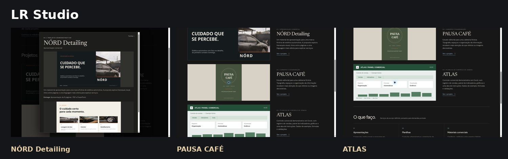

# LR Studio

Portfólio de Lucas Resende, em Criciúma (SC).

Apresentações, planilhas e materiais digitais para negócios e profissionais.

NÓRD Detailing, PAUSA CAFÉ e ATLAS são estudos demonstrativos, com marcas e dados fictícios.

[Abrir o portfólio](https://osacul1.github.io/lr-studio-portfolio/) · [Versão em inglês](https://osacul1.github.io/lr-studio-portfolio/en.html)



O site é bilíngue e usa Vite. As páginas apresentam o contexto e os materiais de cada estudo.

## Desenvolvimento

```bash
npm install
npm run dev
```

Para criar uma versão de produção, execute `npm run build`.
